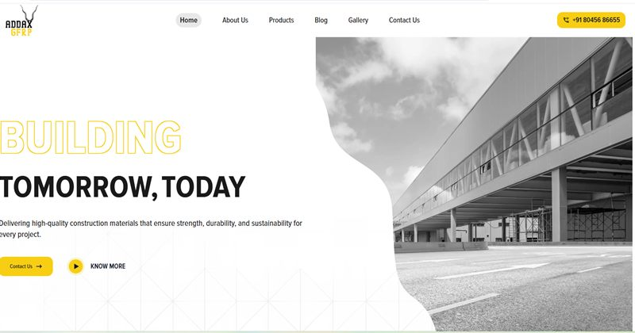
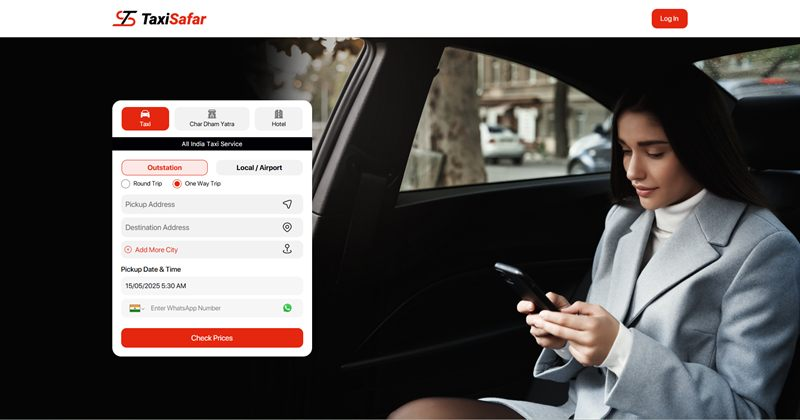
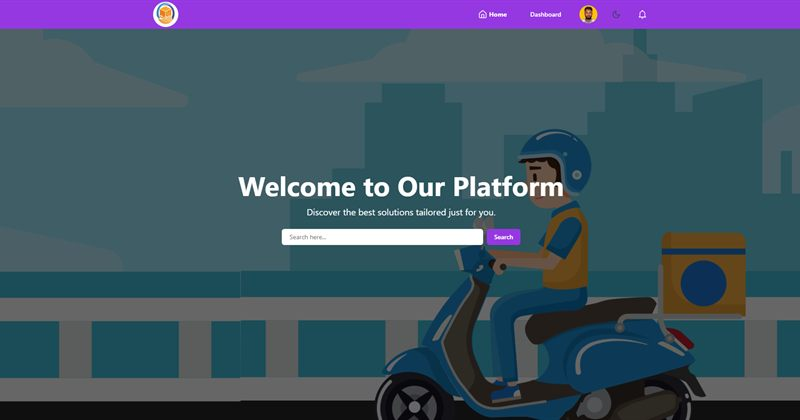
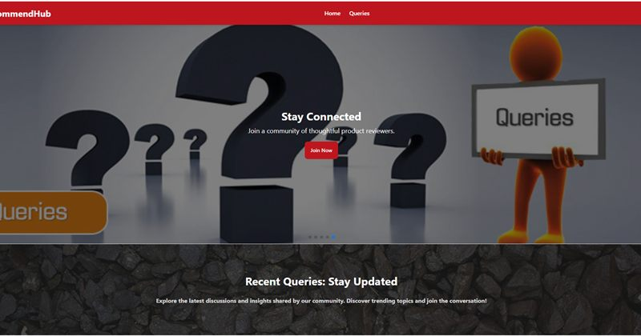
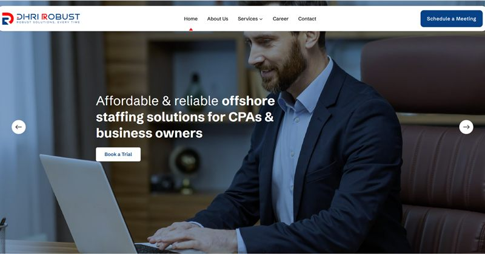
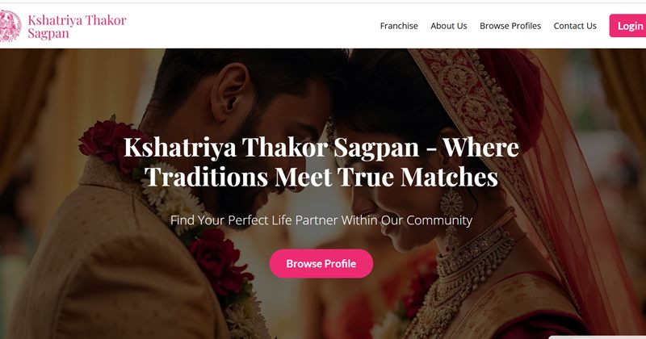

<!-- Header -->
<p align="center">
  
</p>

<p align="center">
  <a href="https://www.abdur-razzak.site/">
    
  </a>
</p>

<p align="center">
  <a href="https://www.abdur-razzak.site/"></a>
  <a href="https://www.upwork.com/freelancers/~01cbcc4bb65e1d54ef"></a>
  <a href="mailto:abrazzak6980@gmail.com"></a>
  
  
  
</p>

---

## 👋 About Me

I'm a **full stack developer** who builds modern, responsive and scalable web applications — from pixel-perfect front ends to secure, well-structured APIs. As a **Top Rated freelancer on Upwork**, I've helped startups and businesses across the globe turn their ideas into production-ready products.

```js
const abdurRazzak = {
  role: "Full Stack Developer",
  basedIn: "Dhaka, Bangladesh 🇧🇩",
  codingSince: 2018,
  clientsFrom: ["USA", "UK", "Canada", "Germany", "Australia"],
  stack: {
    frontend: ["React", "Next.js", "TypeScript", "Tailwind CSS", "Redux"],
    backend: ["Node.js", "Express", "MongoDB", "MySQL", "Firebase"],
    cms: ["WordPress"],
  },
  currentlyLearning: ["Advanced TypeScript", "Next.js", "Cloud platforms"],
  openToWork: true,
  funFact: "Best ideas arrive between cricket matches and late-night coding 🏏🌙",
};
```

---

## 💼 What I Offer

<table>
  <tr>
    <td width="33%" valign="top">
      <b>⚛️ Frontend Development</b><br />
      Fast, responsive React &amp; Next.js apps with clean, reusable components.
    </td>
    <td width="33%" valign="top">
      <b>🛠️ Backend &amp; APIs</b><br />
      Secure REST APIs with Node.js, Express, MongoDB / MySQL and JWT auth.
    </td>
    <td width="33%" valign="top">
      <b>🧩 Full Stack MERN Apps</b><br />
      Dashboards, authentication, role-based access and payments — end to end.
    </td>
  </tr>
  <tr>
    <td width="33%" valign="top">
      <b>🎨 Figma → Code</b><br />
      Pixel-perfect design conversion with smooth GSAP &amp; Framer Motion animations.
    </td>
    <td width="33%" valign="top">
      <b>📝 WordPress Websites</b><br />
      Business and marketing sites that your team can edit with ease.
    </td>
    <td width="33%" valign="top">
      <b>⚡ Performance &amp; SEO</b><br />
      Lighthouse-friendly, accessible builds that load fast and rank well.
    </td>
  </tr>
</table>

---

## 🚀 Featured Projects

<table>
  <tr>
    <td width="50%" valign="top">
      <a href="https://addex-frontend.vercel.app/"></a>
      <h3>ADDAX GFRP</h3>
      Corporate website for a construction-materials brand, with a product catalogue, blog, gallery and scroll-driven animations.<br /><br />
      <code>Next.js</code> <code>Tailwind</code> <code>GSAP</code> <code>Express</code><br /><br />
      <a href="https://addex-frontend.vercel.app/">🌐 Live demo</a>
    </td>
    <td width="50%" valign="top">
      <a href="https://vicky-cabs-teal.vercel.app/"></a>
      <h3>TaxiSafar</h3>
      Cab booking platform for outstation, local and airport rides — round trips, one-way trips and multi-city routes.<br /><br />
      <code>Next.js</code> <code>TypeScript</code> <code>MySQL</code> <code>CSS</code><br /><br />
      <a href="https://vicky-cabs-teal.vercel.app/">🌐 Live demo</a>
    </td>
  </tr>
  <tr>
    <td width="50%" valign="top">
      <a href="https://parcel-management-app-d81f7.web.app/"></a>
      <h3>Parcel Management</h3>
      MERN delivery platform with role-based access (Admin, Delivery, User), parcel booking, delivery tracking, payments and analytics.<br /><br />
      <code>React</code> <code>Node.js</code> <code>MongoDB</code> <code>shadcn/ui</code> <code>Tailwind</code><br /><br />
      <a href="https://parcel-management-app-d81f7.web.app/">🌐 Live demo</a> · <a href="https://github.com/fabrazzak/Parcel-management-appk-client">💻 Source code</a>
    </td>
    <td width="50%" valign="top">
      <a href="https://queries-b074f.web.app/"></a>
      <h3>RecommendHub</h3>
      Product query &amp; recommendation platform where users post questions and the community shares honest recommendations.<br /><br />
      <code>React</code> <code>Express</code> <code>MongoDB</code> <code>Tailwind</code><br /><br />
      <a href="https://queries-b074f.web.app/">🌐 Live demo</a> · <a href="https://github.com/fabrazzak/RecommendHub-query-website--client">💻 Source code</a>
    </td>
  </tr>
  <tr>
    <td width="50%" valign="top">
      <a href="https://dhrirobust.vercel.app/"></a>
      <h3>DHRI ROBUST</h3>
      Pixel-perfect, fully responsive site for an offshore staffing &amp; bookkeeping firm serving CPAs and business owners.<br /><br />
      <code>Next.js</code> <code>Tailwind</code> <code>GSAP</code><br /><br />
      <a href="https://dhrirobust.vercel.app/">🌐 Live demo</a>
    </td>
    <td width="50%" valign="top">
      <a href="https://kt-matrimony.vercel.app/"></a>
      <h3>KT Matrimony</h3>
      Community matrimony platform with profile browsing, free registration and a franchise programme.<br /><br />
      <code>React</code> <code>Express</code> <code>MySQL</code> <code>Tailwind</code><br /><br />
      <a href="https://kt-matrimony.vercel.app/">🌐 Live demo</a>
    </td>
  </tr>
</table>

<p align="center">
  <a href="https://www.abdur-razzak.site/"></a>
</p>

---

## 🛠️ Tech Stack

**Languages**
<p>
  
</p>

**Frontend**
<p>
  
</p>

**Backend, Database & CMS**
<p>
  
</p>

**Tools & Platforms**
<p>
  
</p>

**Also working with**
<p>
  
  
  
  
  
  
  
  
</p>

---

## 📊 GitHub Stats

<p align="center">
  <picture>
    <source media="(prefers-color-scheme: dark)" srcset="https://github-profile-summary-cards.vercel.app/api/cards/profile-details?username=fabrazzak&theme=github_dark" />
    
  </picture>
</p>

<p align="center">
  <picture>
    <source media="(prefers-color-scheme: dark)" srcset="https://github-profile-summary-cards.vercel.app/api/cards/stats?username=fabrazzak&theme=github_dark" />
    
  </picture>
  <picture>
    <source media="(prefers-color-scheme: dark)" srcset="https://github-profile-summary-cards.vercel.app/api/cards/most-commit-language?username=fabrazzak&theme=github_dark" />
    
  </picture>
</p>

<p align="center">
  <picture>
    <source media="(prefers-color-scheme: dark)" srcset="https://streak-stats.demolab.com?user=fabrazzak&theme=github-dark-blue&hide_border=true" />
    
  </picture>
</p>

### 🧊 3D Contribution Graph

<p align="center">
  <picture>
    <source media="(prefers-color-scheme: dark)" srcset="profile-3d-contrib/profile-night-rainbow.svg" />
    
  </picture>
</p>

### 🐍 Contribution Snake

<p align="center">
  <picture>
    <source media="(prefers-color-scheme: dark)" srcset="https://raw.githubusercontent.com/fabrazzak/fabrazzak/output/github-snake-dark.svg" />
    
  </picture>
</p>

---

## 💬 Dev Quote of the Day

<p align="center">
  <picture>
    <source media="(prefers-color-scheme: dark)" srcset="https://quotes-github-readme.vercel.app/api?type=horizontal&theme=tokyonight" />
    
  </picture>
</p>

---

## 🤝 Let's Connect

<p align="center">
  <a href="https://www.abdur-razzak.site/"></a>
  <a href="https://www.upwork.com/freelancers/~01cbcc4bb65e1d54ef"></a>
  <a href="https://www.linkedin.com/in/abdur--razzak/"></a>
  <a href="mailto:abrazzak6980@gmail.com"></a>
  <a href="https://wa.me/8801703906980"></a>
  <a href="https://www.youtube.com/@AbdurRazzak-i2f"></a>
  <a href="https://www.facebook.com/Abdurrazzak309/"></a>
</p>

<p align="center">
  <b>Have a project in mind? Let's build something amazing together! 🚀</b><br />
  <a href="https://www.upwork.com/freelancers/~01cbcc4bb65e1d54ef"></a>
</p>

<!-- Footer -->
<p align="center">
  
</p>
