<!-- Animated artwork in assets/svg is generated by scripts/build-assets.mjs -->
<a href="https://www.abdur-razzak.site/">
  
</a>

  

  
  
  
  
  
  


##  About Me

I'm a **full stack developer** who builds modern, responsive and scalable web applications — from pixel-perfect front ends to secure, well-structured APIs. As a **Top Rated freelancer on Upwork**, I've helped startups and businesses across the globe turn their ideas into production-ready products.


##  What I Offer


##  Featured Projects

<table>
  <tr>
    <td width="50%" valign="top">
      <a href="https://addex-frontend.vercel.app/"></a>
      <h3>ADDAX GFRP</h3>
      Corporate website for a construction-materials brand, with a product catalogue, blog, gallery and scroll-driven animations.  
      <code>Next.js</code> <code>Tailwind</code> <code>GSAP</code> <code>Express</code>  
      <a href="https://addex-frontend.vercel.app/">🌐 Live demo</a>
    </td>
    <td width="50%" valign="top">
      <a href="https://vicky-cabs-teal.vercel.app/"></a>
      <h3>TaxiSafar</h3>
      Cab booking platform for outstation, local and airport rides — round trips, one-way trips and multi-city routes.  
      <code>Next.js</code> <code>TypeScript</code> <code>MySQL</code> <code>CSS</code>  
      <a href="https://vicky-cabs-teal.vercel.app/">🌐 Live demo</a>
    </td>
  </tr>
  <tr>
    <td width="50%" valign="top">
      <a href="https://parcel-management-app-d81f7.web.app/"></a>
      <h3>Parcel Management</h3>
      MERN delivery platform with role-based access (Admin, Delivery, User), parcel booking, delivery tracking, payments and analytics.  
      <code>React</code> <code>Node.js</code> <code>MongoDB</code> <code>shadcn/ui</code> <code>Tailwind</code>  
      <a href="https://parcel-management-app-d81f7.web.app/">🌐 Live demo</a> · <a href="https://github.com/fabrazzak/Parcel-management-appk-client">💻 Source code</a>
    </td>
    <td width="50%" valign="top">
      <a href="https://queries-b074f.web.app/"></a>
      <h3>RecommendHub</h3>
      Product query &amp; recommendation platform where users post questions and the community shares honest recommendations.  
      <code>React</code> <code>Express</code> <code>MongoDB</code> <code>Tailwind</code>  
      <a href="https://queries-b074f.web.app/">🌐 Live demo</a> · <a href="https://github.com/fabrazzak/RecommendHub-query-website--client">💻 Source code</a>
    </td>
  </tr>
  <tr>
    <td width="50%" valign="top">
      <a href="https://dhrirobust.vercel.app/"></a>
      <h3>DHRI ROBUST</h3>
      Pixel-perfect, fully responsive site for an offshore staffing &amp; bookkeeping firm serving CPAs and business owners.  
      <code>Next.js</code> <code>Tailwind</code> <code>GSAP</code>  
      <a href="https://dhrirobust.vercel.app/">🌐 Live demo</a>
    </td>
    <td width="50%" valign="top">
      <a href="https://kt-matrimony.vercel.app/"></a>
      <h3>KT Matrimony</h3>
      Community matrimony platform with profile browsing, free registration and a franchise programme.  
      <code>React</code> <code>Express</code> <code>MySQL</code> <code>Tailwind</code>  
      <a href="https://kt-matrimony.vercel.app/">🌐 Live demo</a>
    </td>
  </tr>
</table>

  

##  Tech Stack


  
  
  
  
  
  
  
  

##  Latest from my Blog

<!-- BLOG-POSTS:START -->
<table>
  <tr>
    <td width="50%" valign="top">
      
      <h4><a href="https://www.abdur-razzak.site/blog/handling-scope-creep-how-to-protect-your-time-and-deliver-projects-on-schedule">Handling Scope Creep: How to Protect Your Time and Deliver Projects on Schedule</a></h4>
      Career · 8 min read · Mar 16, 2026
      
Practical strategies for freelance and agency developers to identify, prevent, and respond to scope creep without…

    </td>
    <td width="50%" valign="top">
      
      <h4><a href="https://www.abdur-razzak.site/blog/free-learning-resources-for-web-developers-in-2025-the-complete-guide">Free Learning Resources for Web Developers in 2025: The Complete Guide</a></h4>
      Career · 8 min read · Mar 12, 2026
      
A curated collection of free courses, documentation sites, YouTube channels, and practice platforms that cover every…

    </td>
  </tr>
  <tr>
    <td width="50%" valign="top">
      
      <h4><a href="https://www.abdur-razzak.site/blog/working-with-international-clients-as-a-freelance-developer-communication-and-contracts">Working with International Clients as a Freelance Developer: Communication and Contracts</a></h4>
      Career · 8 min read · Mar 8, 2026
      
Practical advice for freelance developers on managing international client relationships, time zone differences…

    </td>
    <td width="50%" valign="top">
      
      <h4><a href="https://www.abdur-razzak.site/blog/clean-code-principles-every-developer-should-apply-from-day-one">Clean Code Principles Every Developer Should Apply From Day One</a></h4>
      Career · 9 min read · Mar 5, 2026
      
Learn the practical clean code habits — naming, functions, structure, and design — that make your code readable…

    </td>
  </tr>
</table>
<!-- BLOG-POSTS:END -->

  

##  GitHub Stats

  <picture>
    <source media="(prefers-color-scheme: dark)" srcset="https://github-profile-summary-cards.vercel.app/api/cards/profile-details?username=fabrazzak&theme=github_dark" />
    
  </picture>

  <picture>
    <source media="(prefers-color-scheme: dark)" srcset="https://github-profile-summary-cards.vercel.app/api/cards/stats?username=fabrazzak&theme=github_dark" />
    
  </picture>
  <picture>
    <source media="(prefers-color-scheme: dark)" srcset="https://github-profile-summary-cards.vercel.app/api/cards/most-commit-language?username=fabrazzak&theme=github_dark" />
    
  </picture>

  <picture>
    <source media="(prefers-color-scheme: dark)" srcset="https://streak-stats.demolab.com?user=fabrazzak&theme=github-dark-blue&hide_border=true" />
    
  </picture>

### 🧊 3D Contribution Graph

  <picture>
    <source media="(prefers-color-scheme: dark)" srcset="profile-3d-contrib/profile-night-rainbow.svg" />
    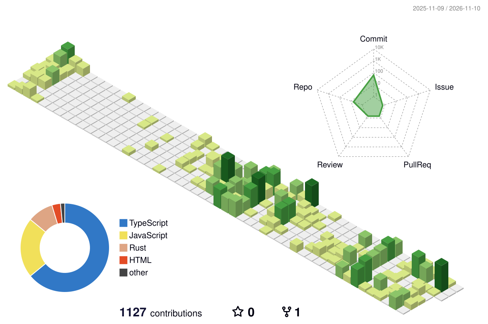
  </picture>

### 🐍 Contribution Snake

  <picture>
    <source media="(prefers-color-scheme: dark)" srcset="https://raw.githubusercontent.com/fabrazzak/fabrazzak/output/github-snake-dark.svg" />
    
  </picture>

##  Working Worldwide


##  Dev Quote of the Day

  <picture>
    <source media="(prefers-color-scheme: dark)" srcset="https://quotes-github-readme.vercel.app/api?type=horizontal&theme=tokyonight" />
    
  </picture>

##  Let's Connect

  
  
  
  
  
  
  

  <b>Have a project in mind? Let's build something amazing together! 🚀</b> 
  

<a href="https://www.abdur-razzak.site/">
  
</a>

  3D emoji: <a href="https://github.com/microsoft/fluentui-emoji">Microsoft Fluent Emoji</a> (MIT) · Tech icons: <a href="https://github.com/tandpfun/skill-icons">Skill Icons</a> (MIT) · Artwork built with <a href="scripts/build-assets.mjs">scripts/build-assets.mjs</a>

